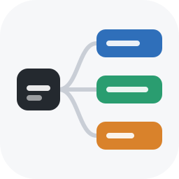
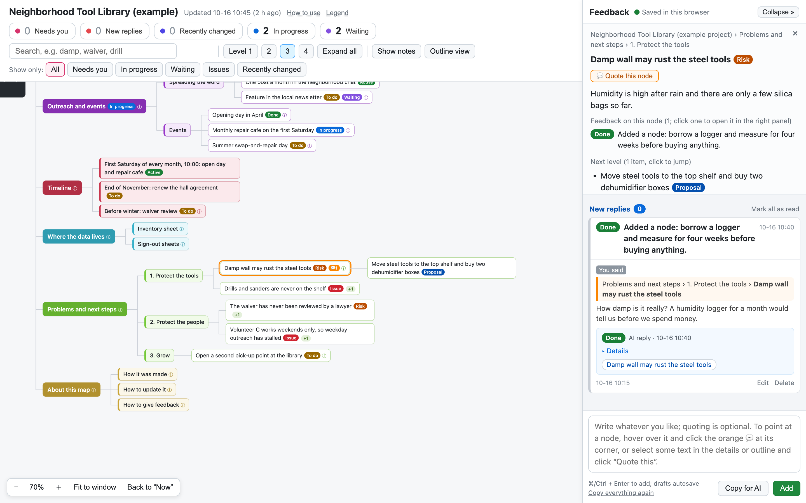
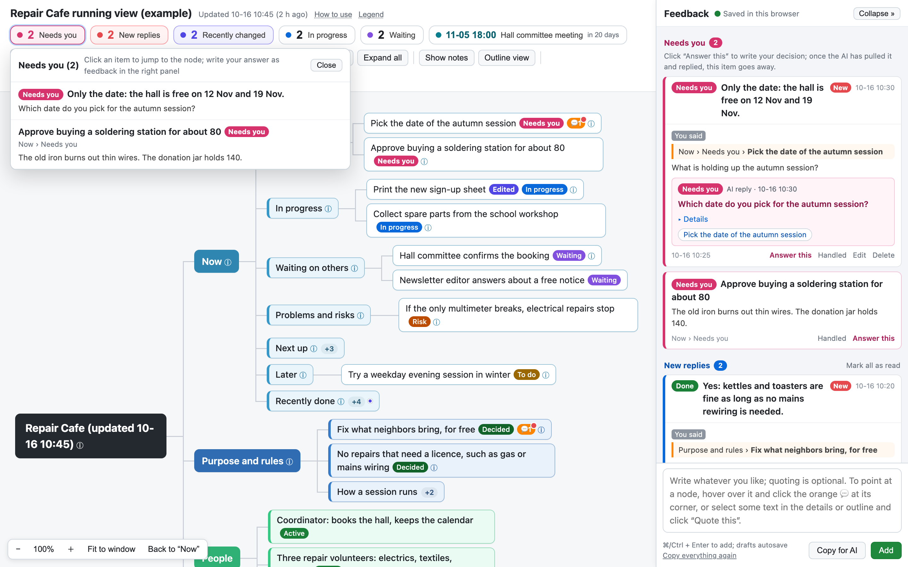

<div align="center">



# mind-atlas

**Turn any project, system or topic into an interactive, multi-level mind map. Your AI agent makes it; you open it with a double-click.**

Pick a level from a quick overview to a full panorama, let sub-agents research the branches,
and get one HTML file with search, an outline view, and a feedback panel that talks back to the agent.
English and Chinese interface. For Claude Code and Codex.

[](https://github.com/jessepwj/mind-atlas/actions/workflows/ci.yml)
[](LICENSE)
[](#requirements)
[](https://code.claude.com/docs/en/skills)
[](#codex)
[](CONTRIBUTING.md)

**English** · [简体中文](README.zh-CN.md)

[Live demo (English)](https://jessepwj.github.io/mind-atlas/tool-library.html) ·
[在线演示（中文）](https://jessepwj.github.io/mind-atlas/book-corner.html) ·
[Console demo (English)](https://jessepwj.github.io/mind-atlas/repair-cafe.html) ·
[控制台演示（中文）](https://jessepwj.github.io/mind-atlas/repair-cafe-zh.html)

</div>

---



Version 1.2 starts every map with **what it is for**: learning a thing, keeping track of a project, or laying out a
decision. A tracking map gets a fixed seven-section "Now" branch, and the build tells the agent when that branch has gone
stale. See [Choose a use](#choose-a-use) and [Maps you keep open for days](#maps-you-keep-open-for-days).

Version 1.1 added a **console for maps you keep open for days**: five numbers at the top of the page, replies that
come with a one-line conclusion and a status, and feedback the agent can pull out of your browser.



## The problem

Ask an agent to "explain how this project fits together" and you get a wall of text. You read it once, you
forget half of it, and the next question starts from zero. A flat summary cannot show structure, and you
cannot argue with it point by point.

## What mind-atlas is

mind-atlas is a **skill** (a bundle of instructions, scripts and a page template) for coding agents such as
**Claude Code** and **Codex**. Ask your agent to map something out. It will:

1. **Choose a use and a level** that fit your purpose: learn a thing, track a project or decide between options, from a 30-node overview to a 1,000-node panorama.
2. **Read the core material itself** to get the trunk, and, for bigger maps, **fan out read-only
   sub-agents**, one per branch, with a brief that demands sources.
3. **Check the reports against the real sources**, because sub-agents often read stale documents.
4. **Write an outline** and build **one HTML file**: a horizontal tree you can pan, zoom, search and fold.
5. **Collect your reactions on the map itself.** Quote a node or a sentence, write what you think, then
   click *Copy for AI* and paste it into the chat, or just tell the agent "pull my feedback". The agent
   answers each item and rebuilds the page; your reply appears under your feedback.

The method comes from a real run: a 700-node, 16-branch panorama of a large system, researched by 7 parallel
sub-agents. The page and the feedback loop stayed because they worked.

## Features

- **Four levels, chosen for you.** L1 overview to L4 panorama, with node counts, sub-agent counts and the
  work of each level spelled out ([levels](skills/mind-atlas/references/levels.md)).
- **Read-only parallel research** with a brief template that asks for sources and a self-check before
  reporting, and a rule that the main agent re-verifies key statuses.
- **A page that opens with a double-click.** One file, all data embedded, no server, no network (a content
  security policy enforces it), nothing to install for the reader.
- **A map you can use.** Branch colors, eleven status badges, notes behind an ⓘ, `+N` counts on collapsed
  branches; drag to pan, pinch or Ctrl/⌘-scroll to zoom; expand to level 1, 2, 3, 4 or all; search with
  next and previous; an outline view; a details panel with breadcrumb, sources and one-click navigation.
- **Feedback on the map.** Quote a node or a single sentence, write freely, copy it for the agent or let it
  pull it from your browser. Feedback is saved in your browser; replies come back in the rebuilt page.
- **A use for every map** (new in 1.2). `"use"` in `meta.json` (learning, project tracking or decision) shows in the
  page header and decides how the branches are ordered. A learning map ends with "What this means for us", so you
  can pick a next step.
- **A console for project-tracking maps** (1.1, extended in 1.2). A "Now" branch with seven fixed sections feeds
  five numbers at the top (needs you, new replies, recently changed, in progress, waiting); replies carry a
  one-line conclusion, a status and related nodes; nodes that are new or edited since you last looked are marked;
  `pull_feedback.py` fetches your feedback from the browser when you say "pull my feedback". On every build the
  agent is told what in "Now" is out of date.
- **English and Chinese**, both in the page interface (`"lang"` in `meta.json`) and in the outline syntax
  (`[active]` or `【在用】`, ` | ` or ` ｜ `, `[src: ...]` or `〔...〕`). More languages are one block in
  `i18n.json`.
- **Strict about structure.** The build stops on tab indentation, odd or skipped levels and a second root,
  with file and line; it warns about ellipsis truncation, empty and duplicate titles.
- **Standard library only.** Python 3.9 or newer, macOS, Linux and Windows. CI runs the tests on Ubuntu and
  Windows across Python 3.9 to 3.13.

## Choose a use

The same page serves three uses. The use decides how the first-level branches are ordered and whether the map must be
kept up to date afterwards. The agent settles it first and writes it in `meta.json` as `"use"`.

| Use | When | What the map looks like | Afterwards |
|---|---|---|---|
| **Learning** | Understand a project, an app, a mechanism, a pile of material | Key points, what it is, what it is made of, how it works, how to use it, limits, **what this means for us**, about this map | Read once or twice; no upkeep |
| **Project tracking** | A project that runs for many days and you need to know where it stands | A **Now** branch first, then purpose and blueprint, detail branches, problems, history | Updated whenever the project moves; the build checks that "Now" is not stale |
| **Decision** | Choose between a few options | What must be decided, one branch per option, a recommendation marked as a proposal, what is still unclear | Mark the choice as decided; often one branch inside a tracking map |

## Choose a level

Not every map has to be exhaustive. The skill picks the level from your purpose, the scope and your words
("the whole picture" means L4), and tells you which one it chose so you can ask for more or less.

| Level | Purpose | Depth / nodes | Sub-agents |
|---|---|---|---|
| **L1 Overview** | A first impression, or explain it to someone | 2-3 levels, 30-80 | none |
| **L2 Standard** | Understand a project or topic, spot obvious problems | 3 levels, 80-200 | 1-3 on the unfamiliar branches |
| **L3 Detailed** | Decide something, or rework one part | 4 levels, 200-450 | 3-5, split by module |
| **L4 Panorama** | Optimize everything, set the blueprint | 4-5 levels, 500-1000 | 6-8, one per line, plus cross-cutting ones |

## Quick start

### Requirements

- An agent that supports skills: [Claude Code](https://code.claude.com) or [Codex](https://openai.com/codex).
- Python 3.9 or newer (`python3` on macOS and Linux, `python` or `py` on Windows). Nothing to `pip install`.
- A browser to read the page. It was built and tested with Chrome; other current browsers should work.

### Claude Code

Copy the skill folder into your skills directory, then just ask.

```bash
git clone https://github.com/jessepwj/mind-atlas.git
mkdir -p ~/.claude/skills
cp -r mind-atlas/skills/mind-atlas ~/.claude/skills/mind-atlas
```

On Windows (PowerShell):

```powershell
git clone https://github.com/jessepwj/mind-atlas.git
New-Item -ItemType Directory -Force "$HOME\.claude\skills" | Out-Null
Copy-Item -Recurse mind-atlas\skills\mind-atlas "$HOME\.claude\skills\mind-atlas"
```

For one project only, copy it to `<project>/.claude/skills/mind-atlas` instead. Then, in a Claude Code
session:

```text
Map out how this repository works as a mind map. The page should be in English.
```

### Codex

```bash
mkdir -p ~/.codex/skills
cp -r mind-atlas/skills/mind-atlas ~/.codex/skills/mind-atlas
```

```text
Use $mind-atlas to map out this project. I want to decide what to refactor first.
```

### As a Claude Code plugin

```text
/plugin marketplace add jessepwj/mind-atlas
/plugin install mind-atlas@mind-atlas-marketplace
```

### Without an agent

The scripts work by themselves. Write `meta.json` and an outline by hand
([format](skills/mind-atlas/references/outline-format.md)), then:

```bash
python3 skills/mind-atlas/scripts/build.py examples/tool-library-en
```

and open the `.html` file it writes. See the [examples](#examples-and-live-demos).

## How it works

```text
you ──ask──▶ agent picks a level ──▶ reads the core material (trunk)
                                      │
                         ┌────────────┴────────────┐
                         ▼                         ▼
              sub-agents research branches   main agent writes the trunk
              (read-only, parallel)          and the cross-cutting branches
                         │                         │
                         └──▶ report ──▶ checked against the sources ──▶ outline-*.md
                                                   │
                                      build.py ──▶ one HTML file ──▶ you read it
                                                   ▲                      │
                                      reply.py ◀── agent answers ◀── "Copy for AI"
```

The ten steps, the sub-agent rules and the pitfalls are in [`SKILL.md`](skills/mind-atlas/SKILL.md).

## Maps you keep open for days

Most maps are read once. For one you keep open, answer again and again and the agent keeps updating (a
project's control map, say), there is a console:

- **Five numbers under the title:** *Needs you*, *New replies*, *Recently changed*, *In progress*, *Waiting*.
  Click one to see its items, click an item to jump to the node. They come from a first-level **"Now" branch**
  (`"now": "Now"` in `meta.json`) and the `[needs-you]` status tag. Beside them, the next point in time.
- **Seven fixed sections in "Now"** (1.2): *Needs you*, *In progress*, *Waiting on others*, *Problems and risks*,
  *Next up* (every title starts with a date), *Later* and *Recently done* (the last two days, about ten items).
  The agent updates "Now" in the same step as the project notes, and a node that moves keeps its title, so old
  quotes and replies still find it.
- **A check that "Now" is not stale** (1.2): every build of a map with `"now"` reports time points that have
  passed, time points without a date, "today" and "tomorrow" wording, a "Recently done" that has grown too long
  or holds unfinished work, an empty *Needs you*, and nodes outside "Now" still tagged *In progress* or *Waiting*.
  It only prints; the page is built either way.
- **Replies that are quick to read:** a bold one-line conclusion, a coloured status (Done, In progress, Planned,
  Dropped, Needs you), details that fold open, and chips for the related nodes. The right panel lists questions
  for you first, then new replies, then items waiting for the agent, then the handled ones folded by date.
- **What changed since you last looked:** every node has a content fingerprint; new and edited nodes are marked
  *New* and *Edited*, and a dot beside `+N` tells you something changed inside a collapsed branch.
- **Stable names:** `root_key` keeps node paths valid while the root title carries the update time
  (`{{updated}}`), so old quotes survive. A page left open offers a refresh when you rebuild it.
- **Feedback without pasting:** say "pull my feedback" and the agent runs `pull_feedback.py`, which reads your items from
  the browser's local storage (a copy of it, read-only, only when you ask; never on a timer). *Copy for AI* remains as the fallback.

Two small examples show it, with live demos: [English](https://jessepwj.github.io/mind-atlas/repair-cafe.html) and
[中文](https://jessepwj.github.io/mind-atlas/repair-cafe-zh.html). The setup is in
[outline-format](skills/mind-atlas/references/outline-format.md#project-tracking-maps-the-now-branch) and the details of the
loop in [docs/feedback-loop.md](docs/feedback-loop.md).

## Using the page

- **Look around.** Drag to pan. Two-finger swipe on a trackpad also pans; pinch, or hold Ctrl/⌘ and scroll,
  to zoom. *Fit to window* and *Back to "Now"* sit in the zoom bar at the bottom left of the map.
- **Fold and unfold.** Click a node to select it and expand it; click it again to collapse it. The header
  buttons expand to level 1, 2, 3, 4 or everything. *Show notes* prints every note on the map.
- **Read the details.** Click a node: its path, status, note, sources and children appear in the right
  panel, and each child is a link.
- **Find things.** Type in the search box; Enter jumps to the next hit, Shift+Enter to the previous one.
  *Outline view* switches to a foldable list, which is easier for long text.
- **Give feedback.** See below.

## The feedback loop

1. **Write.** In the right panel, type what you think: a question, something you do not understand, a
   correction, a decision. To refer to a node, hover over it and click the orange 💬 at its corner, or select
   a sentence in the details or the outline view and click *Quote this*. Quoting is optional.
2. **Hand it over.** Either click *Copy for AI*: all feedback without a reply that you have not copied yet becomes
   one block of text, starting with `[Mind map feedback]`, which you paste into the chat. Or tell the agent
   "pull my feedback": it reads your feedback from the browser itself.
3. **Reply.** The agent handles each item and runs `reply.py`, which writes the reply to `replies.json` and
   rebuilds the page. If you asked for a change, it edits the outline first. A reply can carry a one-line
   conclusion, a status and related nodes.
4. **Refresh.** Reload the page: the reply appears under your feedback.

Feedback lives in your browser's `localStorage`, keyed by the map's `id`, so it never leaves your machine
until you paste it. More detail, including the block format: [docs/feedback-loop.md](docs/feedback-loop.md).

## Why a static page and not a server

An early version ran a local server that saved feedback to disk. It was dropped for three reasons:
servers get forgotten and keep running; a chat session can end within the hour and take the server with
it, leaving a dead page; and a map you can double-click needs no explanation. So feedback stays in the
browser, goes out through *Copy for AI* or a one-shot "pull my feedback" (never a service, never on a timer), and
replies come back by rebuilding the page.

## The outline format at a glance

```text
# Neighborhood Tool Library | A shared shed where neighbors borrow tools
- Purpose and rules | Why it exists. [src: Founding notes]
  - Goal: borrow instead of buy [decided] | Started in March.
  - Lending [active]
    - Up to 7 days, renew once [active] | The sign-out sheet is the only record.
      A reminder goes out on day 8.
- Problems and next steps | Items tagged Proposal are the mapper's own judgment.
  - Damp wall may rust the tools [risk]
    - Buy two dehumidifier boxes [proposal]
```

Two spaces per level. ` | ` separates a title from its note, `[src: ...]` gives a source, and eleven
bracketed words give a status: `[needs-you] [active] [stopped] [in progress] [todo] [issue] [done] [decided]
[waiting] [risk] [proposal]`. Everything also works in Chinese (`【在用】`, ` ｜ `, `〔...〕`), and the two spellings
can be mixed. Full reference: [outline-format](skills/mind-atlas/references/outline-format.md).

## Examples and live demos

| Example | Language | Source | Live demo |
|---|---|---|---|
| Neighborhood Tool Library | English | [`examples/tool-library-en`](examples/tool-library-en) | [open](https://jessepwj.github.io/mind-atlas/tool-library.html) |
| 小区旧书漂流角 | 中文 | [`examples/book-corner-zh`](examples/book-corner-zh) | [打开](https://jessepwj.github.io/mind-atlas/book-corner.html) |
| Repair Cafe running view (project tracking) | English | [`examples/repair-cafe-en`](examples/repair-cafe-en) | [open](https://jessepwj.github.io/mind-atlas/repair-cafe.html) |
| 旧物维修咖啡馆长期视图（跟进项目） | 中文 | [`examples/repair-cafe-zh`](examples/repair-cafe-zh) | [打开](https://jessepwj.github.io/mind-atlas/repair-cafe-zh.html) |

The first two are learning maps: they use ten of the status tags, a continuation line, sources, branches attached from
separate files, and end with "What this means for us". The repair cafe pair is small and shows a project-tracking map:
the seven-section "Now" branch and `[needs-you]` items. Only
source files are in the repository; CI builds the demos. To build one yourself:

```bash
python3 skills/mind-atlas/scripts/build.py examples/tool-library-en
```

## Repository layout

```text
mind-atlas/
├── skills/mind-atlas/         the skill (copy this folder into your agent)
│   ├── SKILL.md               instructions for the agent
│   ├── agents/openai.yaml     Codex interface manifest
│   ├── references/            levels, brief template, outline format (English + 简体中文)
│   └── scripts/               build.py, reply.py, pull_feedback.py, template.html, i18n.json
├── examples/                  source files of the four examples
├── docs/                      the feedback loop in detail, screenshots
├── tests/                     unittest suite (standard library)
├── tools/                     demo-site builder, screenshot maker
├── .claude-plugin/            Claude Code plugin and marketplace manifests
└── .github/                   CI, Pages, issue and pull request templates
```

## FAQ

**Do I need to run a server or have internet access?** No. The page is one file that opens from disk. It
contains no external links and a content security policy forbids the page from loading or sending anything.

**Where does my feedback go?** Into your browser's `localStorage` until you click *Copy for AI* and paste it
somewhere, or tell the agent to pull it (the agent then reads a temporary copy of the browser's local storage,
only when you ask). Open the same file in another browser and you will not see it, but the agent's replies still show
up, together with your original words when the agent passed `--orig`.

**Why did my old feedback disappear after I renamed the map?** Feedback is stored under the `id` in
`meta.json`, or under the `title` when there is no `id`. Set a short, stable `id` once and never change it,
and do not give two of your maps the same `id`: the browser shares its storage between local files, so they
would mix their feedback.

**How big a map can it handle?** A map of about 700 nodes builds instantly and works in Chrome. For
anything much bigger, lean on the level buttons and the outline view.

**Is the page interface in my language?** English and Chinese are built in. Set `"lang": "en"` or `"zh"` in
`meta.json` (the default is `"zh"`). Adding a language means adding one block to `i18n.json`; see
[CONTRIBUTING](CONTRIBUTING.md).

**Can I use it without an AI?** Yes. Write the outline by hand and run `build.py`; the agent is only the
convenient part.

**Can I share a page with other people?** Yes. Build with `--no-paths` first
(`python3 skills/mind-atlas/scripts/build.py <folder> --no-paths`): by default the page embeds the absolute path of the file and the
reply command, which tell the agent where to write, and which you may not want to reveal.

**Can I export to PDF or an image?** Not built in. Use the browser's print and screenshot tools, or the
outline view.

**It says "Can't save in this window".** The browser is blocking local storage for the file. Open the page in
a regular browser window, or copy your feedback to the agent as soon as you have written it.

## Contributing

Issues, translations, examples and pull requests are welcome; see [CONTRIBUTING.md](CONTRIBUTING.md). The
most useful report is "I mapped X, and Y went wrong". Please follow the [Code of Conduct](CODE_OF_CONDUCT.md)
and read the [security policy](SECURITY.md) before reporting a vulnerability.

## License

[MIT](LICENSE) © Pan Wenjie
