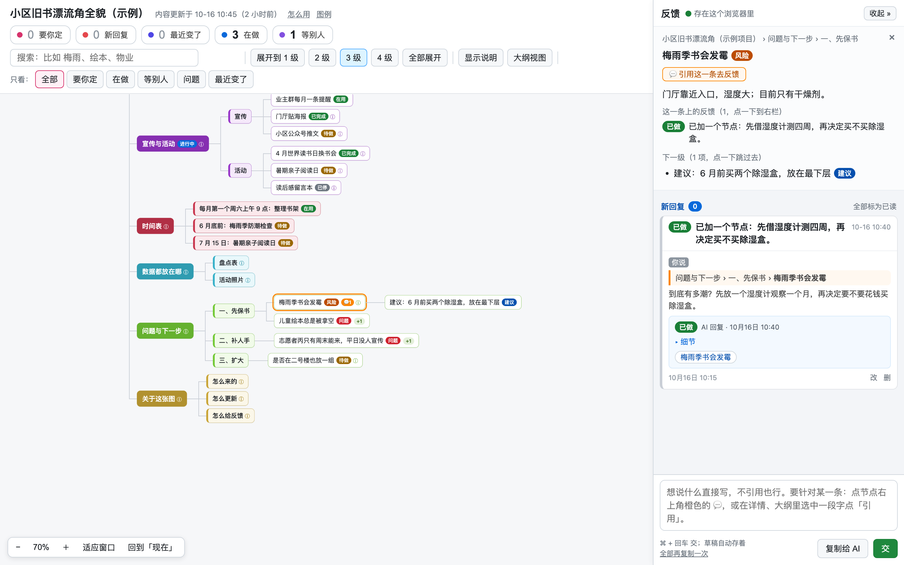
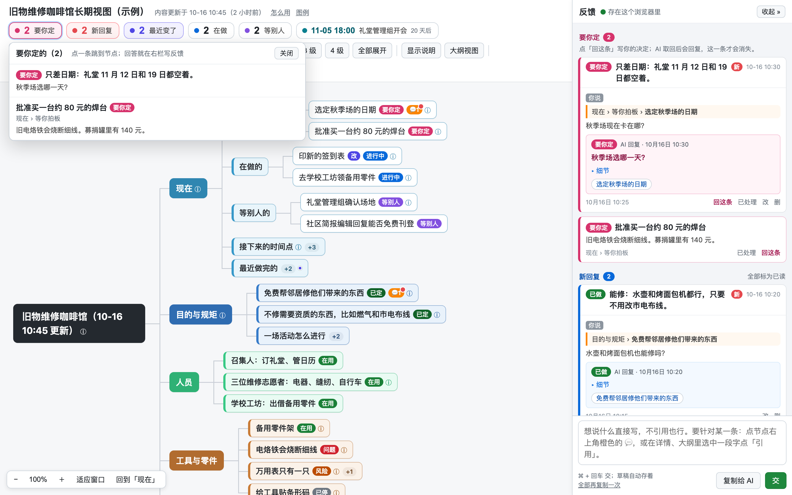

<div align="center">


# mind-atlas

**把任何项目、系统或主题梳理成多级、可交互的思维导图。AI 智能体来做，你双击就能打开。**

先选一个等级，从快速速览到全景梳理；让子智能体并行调研各个分支；
最后得到一个自带搜索、大纲视图和反馈栏的 HTML 文件，反馈还能直接交回给智能体。
中英文界面，支持 Claude Code 和 Codex。

[](https://github.com/jessepwj/mind-atlas/actions/workflows/ci.yml)
[](LICENSE)
[](#环境要求)
[](https://code.claude.com/docs/en/skills)
[](#codex)
[](CONTRIBUTING.zh-CN.md)

[English](README.md) · **简体中文**

[在线演示（中文）](https://jessepwj.github.io/mind-atlas/book-corner.html) ·
[Live demo (English)](https://jessepwj.github.io/mind-atlas/tool-library.html) ·
[控制台演示（中文）](https://jessepwj.github.io/mind-atlas/repair-cafe-zh.html) ·
[Console demo (English)](https://jessepwj.github.io/mind-atlas/repair-cafe.html)

</div>

---



## 它解决的问题

让智能体「讲讲这个项目是怎么组成的」，得到的是一大段文字。你读一遍，忘掉一半，下一个问题又从零开始。
平铺的总结看不出结构，也没法逐条跟它讨论。

1.1 版新增了**给要开上好几天的图用的控制台**：页头五个数字、带一句结论和状态的回复，以及智能体可以自己从你的浏览器里取反馈。
见[开上好几天的图](#开上好几天的图)。



## mind-atlas 是什么

mind-atlas 是面向编码智能体（**Claude Code**、**Codex**）的一个 **skill**（一包指令、脚本和页面模板）。
让你的智能体把某件事梳理出来，它会：

1. **按你的目的选一个等级**，从 30 个节点的速览到 1000 个节点的全景。
2. **自己读核心材料，拿到主干**；图大的时候**派几个只读的子智能体**，每个负责一个分支，派单里要求附来源。
3. **把报告回到真实来源去核对**，因为子智能体常常读到过时的文档。
4. **写成大纲，生成一个 HTML 文件**：一棵横向的树，可以拖动、缩放、搜索、折叠。
5. **在图上收集你的反馈。** 引用一个节点或一句话，写下你的想法，然后点「复制给 AI」粘贴到会话里，
   或者直接对智能体说「去看反馈」。智能体逐条回复并重新生成页面；回复就显示在你的反馈下面。

这套做法来自一次真实的全景梳理：一个大型系统，700 多个节点、16 个一级分支，7 个子智能体并行调研。
页面和反馈回路因为好用而保留了下来。

## 特性

- **四个等级，自动判断。** 从 L1 速览到 L4 全景，每一级的节点数、子智能体数和要做的事都写清楚了
  （见[等级与子智能体](skills/mind-atlas/references/levels.zh-CN.md)）。
- **只读的并行调研**：派单模板要求附来源、交付前自检，并规定主会话要回源核对关键状态。
- **双击就能打开的页面。** 单文件，数据全嵌在里面，不用服务、不联网（内容安全策略强制保证），读者什么都不用装。
- **一张真正好用的图。** 分支配色、十一种状态徽章、ⓘ 后面的说明、收起分支上的 `+N` 计数；拖动平移，捏合或
  Ctrl/⌘ 加滚轮缩放；展开到 1、2、3、4 级或全部；搜索可跳下一处、上一处；大纲视图；详情栏有面包屑、来源和一键跳转。
- **在图上反馈。** 引用整个节点或其中一句，自由书写，复制给智能体，或让它自己从浏览器里取。反馈存在你的浏览器里；回复随重新生成的页面回来。
- **长期使用的图有控制台**（1.1 版新增）。「现在」分支给页头的五个数字供数（要你定、新回复、最近变了、在做、等别人）；
  回复带一句结论、状态和相关节点；上次看过之后新增或改过的节点会被标出来；你说「去看反馈」，`pull_feedback.py` 就从浏览器里把反馈取回来。
- **中英文都支持**：页面界面（`meta.json` 里的 `"lang"`）和大纲写法都是
  （`【在用】` 或 `[active]`，` ｜ ` 或 ` | `，`〔...〕` 或 `[src: ...]`）。再加一种语言，只要在 `i18n.json`
  里添一个块。
- **对结构很严格。** 遇到 Tab 缩进、奇数缩进或跳级、第二个根节点会停下来并指出文件和行号；省略号截断、空标题、
  同级重名会给出警告。
- **只用标准库。** Python 3.9 或更高版本，macOS、Linux、Windows 都能用。CI 在 Ubuntu 和 Windows 上用 Python
  3.9 到 3.13 跑测试。

## 选一个等级

不是每张图都要做到面面俱到。skill 会根据你的目的、范围和你说的话（「全貌」「全景」就是 L4）选一级，
并告诉你选了哪一级，你可以要求更细或更粗。

| 等级 | 目的 | 层级 / 节点 | 子智能体 |
|---|---|---|---|
| **L1 速览** | 快速建立整体印象，或给别人讲清楚 | 2～3 级，30～80 | 不派 |
| **L2 标准** | 理清一个项目或主题，找明显的问题 | 3 级，80～200 | 1～3 个调研不熟的分支 |
| **L3 详细** | 要据此做决定，或改造其中一块 | 4 级，200～450 | 3～5 个，按模块切 |
| **L4 全景** | 整体优化、结构化、定蓝图 | 4～5 级，500～1000 | 6～8 个，每条线一个，再加横向的部分 |

## 快速开始

### 环境要求

- 一个支持 skill 的智能体：[Claude Code](https://code.claude.com) 或 [Codex](https://openai.com/codex)。
- Python 3.9 或更高版本（macOS、Linux 上是 `python3`，Windows 上是 `python` 或 `py`）。不需要 `pip install` 任何东西。
- 一个浏览器来看页面。开发和测试用的是 Chrome，其他较新的浏览器应该也行。

### Claude Code

把 skill 文件夹复制到 skills 目录，然后直接提要求。

```bash
git clone https://github.com/jessepwj/mind-atlas.git
mkdir -p ~/.claude/skills
cp -r mind-atlas/skills/mind-atlas ~/.claude/skills/mind-atlas
```

Windows（PowerShell）：

```powershell
git clone https://github.com/jessepwj/mind-atlas.git
New-Item -ItemType Directory -Force "$HOME\.claude\skills" | Out-Null
Copy-Item -Recurse mind-atlas\skills\mind-atlas "$HOME\.claude\skills\mind-atlas"
```

只想在某个项目里用，就复制到 `<项目>/.claude/skills/mind-atlas`。然后在 Claude Code 会话里说：

```text
把这个仓库是怎么运转的梳理成思维导图，页面用中文。
```

### Codex

```bash
mkdir -p ~/.codex/skills
cp -r mind-atlas/skills/mind-atlas ~/.codex/skills/mind-atlas
```

```text
用 $mind-atlas 把这个项目梳理一遍，我想决定先重构哪一块。
```

### 作为 Claude Code 插件

```text
/plugin marketplace add jessepwj/mind-atlas
/plugin install mind-atlas@mind-atlas-marketplace
```

### 不用智能体

脚本可以单独用。手写 `meta.json` 和大纲（[写法](skills/mind-atlas/references/outline-format.zh-CN.md)），然后：

```bash
python3 skills/mind-atlas/scripts/build.py examples/book-corner-zh
```

打开它写出来的 `.html` 文件。见[示例与在线演示](#示例与在线演示)。

## 工作流程

```text
你 ──提要求──▶ 智能体选等级 ──▶ 读核心材料拿主干
                                  │
                     ┌────────────┴────────────┐
                     ▼                         ▼
          子智能体调研各分支            主会话写主干
          （只读，并行）                和横向分支
                     │                         │
                     └──▶ 报告 ──▶ 回源核对 ──▶ outline-*.md
                                       │
                          build.py ──▶ 一个 HTML 文件 ──▶ 你来看
                                       ▲                      │
                          reply.py ◀── 智能体逐条回复 ◀── 「复制给 AI」
```

十个步骤、子智能体的规矩和常见的坑都在 [`SKILL.md`](skills/mind-atlas/SKILL.md) 里。

## 开上好几天的图

多数图只看一次。如果一张图你要一直开着、反复回话，智能体也在不断更新它（比如某个项目的总控图），1.1 版给它加了控制台：

- **标题下面五个数字：**「要你定」「新回复」「最近变了」「在做」「等别人」。点一个看它的条目，点一条跳到节点。
  数据来自第一个一级分支**「现在」**（`meta.json` 里写 `"now": "现在"`）和新的 `【要你定】` 状态标签。旁边还会显示最近的一个时间点。
- **一眼能读完的回复：** 加粗的一句结论、彩色状态（已做、在做、定了待做、不做、要你定）、点开才看的细节、相关节点的小标签。
  右栏先排要你回答的，再是新回复、等智能体回复的，最后是按日期折叠的已处理。
- **自上次看过以后变了什么：** 每个节点有内容指纹；新增和改过的节点标「新」「改」，收起的分支里有变化，`+N` 旁边会有一个小点。
- **稳定的名字：** `root_key` 让节点路径在根标题带更新时间（`{{更新}}`）时依然有效，旧引用不会失效。页面开着时，重新生成后会提示刷新。
- **不用粘贴的反馈：** 你说「去看反馈」，智能体运行 `pull_feedback.py`，从浏览器的本地存储里读你的条目（读的是副本，只读，你开口才跑，从不定时）。
  「复制给 AI」仍然保留，作后备。

两个小示例演示了这些，都有在线演示：[中文](https://jessepwj.github.io/mind-atlas/repair-cafe-zh.html)和
[English](https://jessepwj.github.io/mind-atlas/repair-cafe.html)。怎么搭见
[大纲写法](skills/mind-atlas/references/outline-format.zh-CN.md#长期使用的图现在分支)，整个回路的细节见
[docs/feedback-loop.zh-CN.md](docs/feedback-loop.zh-CN.md)。

## 页面怎么用

- **看图。** 按住拖动画布；触控板两指滑动也能移；捏合，或按住 Ctrl/⌘ 再滚动滚轮缩放。地图左下角的缩放条里有「适应窗口」和「回到「现在」」。
- **折叠展开。** 点节点会选中它并展开；再点一下选中的节点就收起。页头的按钮可以一键展开到 1、2、3、4 级或全部。「显示说明」会把每个节点的说明都摆出来。
- **看详情。** 点一个节点，右栏会显示它的路径、状态、说明、来源和下一级，下一级每一项都能点着跳过去。
- **找东西。** 在搜索框里输入；回车跳到下一处，Shift 加回车跳到上一处。「大纲视图」换成可折叠的列表，读长文字更舒服。
- **给反馈。** 见下一节。

## 反馈回路

1. **写。** 在右栏写下你的想法：疑问、看不懂的、要改的、你的决定。要指向某个节点，就把鼠标移到它上面，点右上角橙色的 💬，
   或者在详情、大纲视图里选中一句话，点「引用这段」。引用不是必须的。
2. **交给智能体。** 点「复制给 AI」：所有还没有回复、也没复制过的反馈会整理成一段文字，以 `【导图反馈】` 开头，
   粘贴到会话里；或者直接对智能体说「去看反馈」，它自己从浏览器里取。
3. **回复。** 智能体逐条处理，运行 `reply.py`，把回复写进 `replies.json` 并重新生成页面。
   如果你要求改图，它会先改大纲。一条回复可以带一句结论、一个状态和相关节点。
4. **刷新。** 重新加载页面，回复就显示在你的反馈下面。

反馈存在你浏览器的 `localStorage` 里，按导图的 `id` 区分，在你粘贴出去之前不会离开你的电脑。
更多细节（包括那段文字的格式）见 [docs/feedback-loop.zh-CN.md](docs/feedback-loop.zh-CN.md)。

## 为什么是静态页，不起服务

早期做过一版本机服务，交了反馈直接落盘。后来放弃了，原因有三条：服务容易忘了关而一直占着后台；
会话可能一小时就结束，服务跟着没了，页面就废了；能双击打开的东西不需要任何解释。
所以现在反馈留在浏览器里，靠「复制给 AI」或一次性的「去看反馈」交出去（从不常驻，也不定时），回复靠重新生成页面带回来。

## 大纲写法速览

```text
# 小区旧书漂流角 ｜ 在一号楼门厅放一组书架，邻居自带旧书、随手拿走
- 目的与规矩 ｜ 为什么做、按什么规矩运转。〔发起说明〕
  - 目的：让旧书流动起来 【已定】 ｜ 3 月在业主群里提出。
  - 运转规矩 【在用】
    - 每月第一个周六整理一次 【在用】 ｜ 志愿者轮流。
      整理前一天在业主群提醒。
- 问题与下一步 ｜ 标“建议”的是整理方自己的判断。
  - 梅雨季书会发霉 【风险】
    - 6 月前买两个除湿盒 【建议】
```

每级缩进两个空格。` ｜ ` 分隔标题和说明，`〔...〕` 写来源，十一个带括号的词表示状态：
`【要你定】【在用】【已停】【进行中】【待做】【问题】【已完成】【已定】【等别人】【风险】【建议】`。
英文写法同样可用（`[active]`、` | `、`[src: ...]`），两种写法可以混着用。完整说明见
[大纲写法](skills/mind-atlas/references/outline-format.zh-CN.md)。

## 示例与在线演示

| 示例 | 语言 | 源文件 | 在线演示 |
|---|---|---|---|
| 小区旧书漂流角 | 中文 | [`examples/book-corner-zh`](examples/book-corner-zh) | [打开](https://jessepwj.github.io/mind-atlas/book-corner.html) |
| Neighborhood Tool Library | English | [`examples/tool-library-en`](examples/tool-library-en) | [open](https://jessepwj.github.io/mind-atlas/tool-library.html) |
| 旧物维修咖啡馆长期视图（控制台） | 中文 | [`examples/repair-cafe-zh`](examples/repair-cafe-zh) | [打开](https://jessepwj.github.io/mind-atlas/repair-cafe-zh.html) |
| Repair Cafe running view (console) | English | [`examples/repair-cafe-en`](examples/repair-cafe-en) | [open](https://jessepwj.github.io/mind-atlas/repair-cafe.html) |

前两个示例用到了原有的十种状态标签、续行、来源，以及从别的文件接上来的分支；维修咖啡馆这一对很小，演示「现在」分支和一条 `【要你定】`。仓库里只放源文件，演示页由 CI 生成。
想自己生成一份：

```bash
python3 skills/mind-atlas/scripts/build.py examples/book-corner-zh
```

## 目录结构

```text
mind-atlas/
├── skills/mind-atlas/         skill 本体（把这个文件夹复制进你的智能体）
│   ├── SKILL.md               给智能体看的指令
│   ├── agents/openai.yaml     Codex 的界面配置
│   ├── references/            等级、派单模板、大纲写法（English + 简体中文）
│   └── scripts/               build.py、reply.py、pull_feedback.py、template.html、i18n.json
├── examples/                  四个示例的源文件
├── docs/                      反馈回路详解、截图
├── tests/                     unittest 测试（标准库）
├── tools/                     演示站点生成器、截图生成器
├── .claude-plugin/            Claude Code 插件和插件市场配置
└── .github/                   CI、Pages、issue 与 pull request 模板
```

## 常见问题

**要起服务或联网吗？** 都不用。页面是一个从磁盘直接打开的文件，里面没有外部链接，内容安全策略也禁止页面加载或发送任何东西。

**我的反馈存在哪？** 存在你浏览器的 `localStorage` 里，直到你点「复制给 AI」并粘贴到别处，或者让智能体去取（智能体读的是浏览器本地存储的一份临时副本，只在你开口时才读）。用另一个浏览器打开同一个文件，
看不到你写的反馈，但智能体的回复仍会显示出来（智能体回复时带了 `--orig` 的话，还会连同你的原话一起显示）。

**改了导图的名字，之前的反馈怎么没了？** 反馈是按 `meta.json` 里的 `id` 存的，没写 `id` 就按 `title` 存。
写一个简短稳定的 `id`，以后别再改；也别给你的两张图用同一个 `id`：浏览器会在本地文件之间共用存储，反馈会混在一起。

**图可以做多大？** 700 个节点左右的图生成很快，在 Chrome 里能正常用。再大很多的话，多用等级按钮和大纲视图。

**页面界面是我的语言吗？** 内置中文和英文。在 `meta.json` 里写 `"lang": "zh"` 或 `"en"`（默认是 `"zh"`）。
再加一种语言只要在 `i18n.json` 里加一个块，见[参与贡献](CONTRIBUTING.zh-CN.md)。

**不用 AI 能用吗？** 能。自己手写大纲，运行 `build.py` 就行；智能体只是让这件事更省力。

**能把页面发给别人吗？** 能。先用 `--no-paths` 生成（`python3 skills/mind-atlas/scripts/build.py <文件夹> --no-paths`）：默认情况下页面里带着
页面文件的绝对路径和回复命令，好让智能体知道往哪里写回复，而你未必想把这些告诉别人。

**能导出 PDF 或图片吗？** 没有内置。可以用浏览器自带的打印和截图，或者用大纲视图。

**页面提示「这个窗口存不住」怎么办？** 浏览器拦住了这个文件的本地存储。换一个普通的浏览器窗口打开，
或者写完马上复制给智能体。

## 参与贡献

欢迎提 issue、加翻译、加示例、发 pull request，见 [CONTRIBUTING.zh-CN.md](CONTRIBUTING.zh-CN.md)。
最有用的反馈是「我梳理了 X，结果 Y 不对」。请遵守[行为准则](CODE_OF_CONDUCT.md)；报告安全问题前请先读[安全策略](SECURITY.md)。

## 许可证

[MIT](LICENSE) © Pan Wenjie
